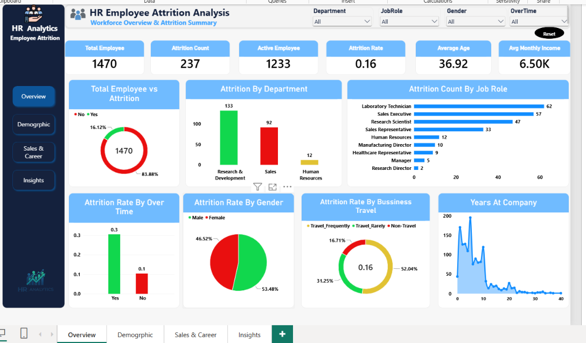

# HR Employee Attrition Analysis

**Goal:** Find the reasons behind **16.1%** employee attrition and where retention efforts will matter most.

## Tools
Python (Pandas, Matplotlib, Seaborn) | SQL (MySQL: CASE, window functions, NTILE, CTEs) | Power BI

## Dataset
- Source:HR Analytics Employee Attrition & Performance (Kaggle)
- Rows and columns: 1,470 rows, 35 columns

## Approach
1. **Exploration (Python):** explored the data to understand its structure and patterns.
2. **Analysis (SQL):** measured attrition by department, role and income using CASE, window functions, NTILE income deciles and CTEs.
3. **Dashboard (Power BI):** presented the findings in an interactive dashboard.

## Key Insights
- Employees working overtime were about **3x more likely to leave** (**30.5%** vs **10.4%**).
- Attrition peaked in the first year of service (**34.9%**) and among Sales Representatives (**39.8%**).

## Recommendations
- Reduce overtime load.
- Strengthen onboarding for new joiners.
- Review workload and pay in Sales roles.

## Dashboard

## Files
- `HR-Employee-Attrition.csv`: dataset
- `HR_Employee_Attrition.ipynb`: data exploration (Python)
- `HR-Employee-Attrition.sql`: SQL analysis
- `HR-Employee_Attrition power bi.pbix`: Power BI dashboard
- `hr_employee_dashboard.png`: dashboard screenshot
